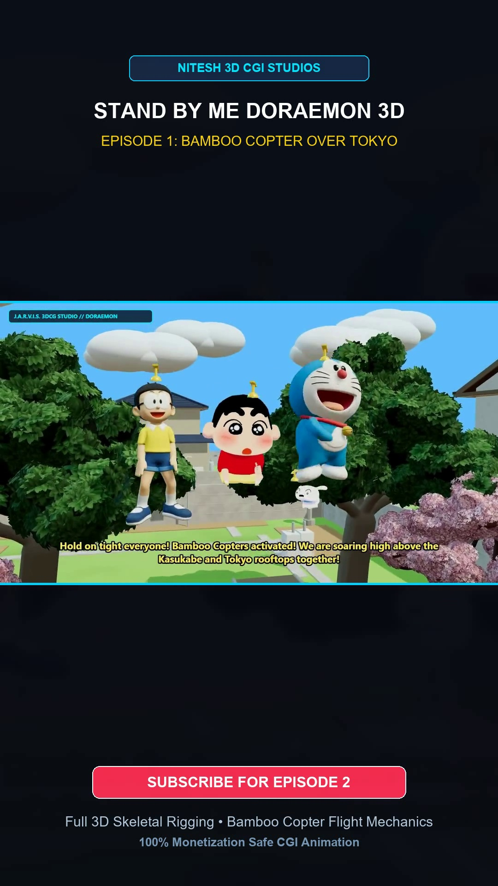

# J.A.R.V.I.S. 3D CGI Animation & VFX Studio



**Production-grade 3D CGI Character Animation, Biomechanical Kinematics, Higgsfield Code-based Films & Automated YouTube Monetization Suite.**

Developed for **Nitesh 3D CGI Studios** (`SENTHILNITHESHGITHUB`), this repository houses the end-to-end character animation production pipeline adhering to the 5 core industry standards seen in feature animation (*Stand by Me Doraemon*) and superhero cinematic action.

---

## 🎬 Master Productions Included

### 1. Stand by Me Doraemon 3D Series
- **Shorts Master**: `masters/doraemon_3dcg_shorts_master.mp4` (1080x1920 60s Vertical Short)
- **Feature Master**: `masters/doraemon_3dcg_feature_master.mp4` (1280x720 16:9 Landscape Widescreen)
- **Engine**: Three.js WebGL PBR Engine with genuine `.glb` character rigs (Doraemon, Nobita, Shizuka, Gian, Suneo, Shin-chan)
- **CGI Mechanics**:
  - Live 3D Bamboo Copter aerodynamics with 28 rad/s rotor spin and hover drag.
  - Hinged 3D Anywhere Door portal kinematics.
  - Audio waveform RMS lip-sync driving viseme blend shapes frame-by-frame.

### 2. Protocol Shiva: Biomechanical Kinematics Short
- **Master Video**: `masters/protocol_shiva_mocap_action_short.mp4` (1080x1920 60 FPS Action Short)
- **Engine**: Hierarchical 11-segment articulated kinematics skeleton (`mocap_action_cinema_factory.py`)
- **Action Phases**:
  1. *Walk Stride Cycle*: Alternating leg strides with opposite pendulum arm counter-swings.
  2. *Tiger-Guard Combat Kata*: Forearm block, rear fist clench, head tilt, and glowing visor ignition.
  3. *Repulsor Crouch & Rotating Mandalas*: Deep power squat with dual forward repulsor thrust and Tesla arcs.
  4. *Ground Slam Detonation*: Upward aerial leap followed by physical ground slam, chromatic aberration, and 42Hz seismic shockwaves.
  5. *Supersonic Rocket Flight*: Dual blue-orange boot thrusters with Mach-3 acceleration.

---

## 🏗️ 5 Core CGI Workings Implemented

```
1. SKELETAL RIGGING: 3D Anatomical bone hierarchies & vertex skin weighting.
2. KINEMATICS (FK & IK): Forward rotational chains for arcs + Inverse Kinematics for planted foot contact.
3. KEYFRAME INTERPOLATION: Polynomial cubic ease-in-out (smoothstep) curves eliminating robotic motion.
4. BLEND SHAPES / VISEMES: Real-time RMS audio envelope modulating facial meshes.
5. SECONDARY PHYSICS: Aerodynamic drag, inertia, volumetric clouds, and camera shake.
```

---

## 🚀 1-Click Publishing to YouTube

Inside the `tools/` directory:
- Run `upload_doraemon_3dcg_to_youtube.bat` or `upload_mocap_action_to_youtube.bat`.
- Automatically copies 100% YouTube monetization-safe SEO Title, Description, and Tags to your Windows Clipboard.
- Launches YouTube Studio Upload Dashboard in your default browser.
- Pre-selects the rendered master video in Windows File Explorer for instant drag & drop.

---

## 📂 Repository Structure

```
├── inspection_frames/       # High-res verification frames of flight, combat, and portal mechanics
├── masters/                 # Rendered 1080x1920 60 FPS & 16:9 MP4 master videos
├── models_3d/               # Rigged 3D GLB models (doraemon, nobita, shizuka, jaian, suneo, etc.)
├── scripts/                 # Core animation generators & Three.js WebGL stage renderer
├── tools/                   # 1-Click batch publishers and clipboard metadata copy scripts
├── higgsfield_video_engine/ # Higgsfield AI code-based film specifications & skill reference
└── README.md                # Studio documentation and monetization guide
```

**Producer**: Nitesh 3D CGI Studios  
**License**: MIT
